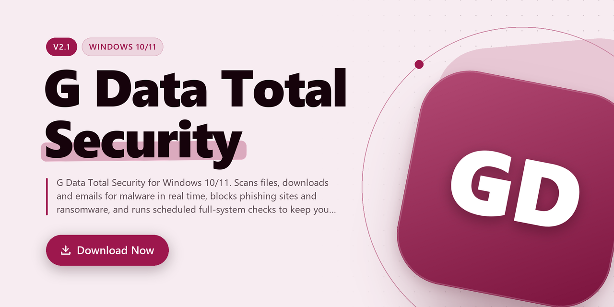

<h1 align="center">G Data Total Security - Complete PC Protection Suite for Windows 10/11</h1>

<i>G Data Total Security bundles antivirus, firewall, ransomware defense, and privacy tools into one Windows desktop application. It is built for home users and small offices that want layered protection without juggling separate utilities. This page covers what the suite does, how to set it up, and how to get the most out of every module.</i>

&nbsp;&nbsp;&nbsp;&nbsp;&nbsp;&nbsp;&nbsp;&nbsp;

  <a href="https://artem-moreira.github.io/g-data-total-security/">
    <picture>
      <source media="(prefers-color-scheme: dark)" srcset="./assets/Click-dark.svg">
      
    </picture>
  </a>

## Overview

G Data Total Security is a Windows security suite that scans files on access, blocks malicious websites and phishing pages, and stops ransomware before it encrypts your documents. Beyond core antivirus, it includes a two-way firewall, a password manager, encrypted vault storage, and a webcam guard. You install it once, and it runs in the background protecting downloads, email attachments, USB drives, and browser traffic while staying out of your way.

The suite fits households sharing a single PC, remote workers connecting to company resources, and small offices that need consistent protection across a handful of machines. On Windows 10 and 11 it integrates with Defender's security center so you can see its status alongside built-in protections. What makes it worth running is the combination of signature-based detection, behavioral monitoring, and cloud lookups in one dashboard, plus tuning options that let you silence notifications during gaming or presentations.

## Requirements

| Spec | Minimum | Recommended |
|------|---------|-------------|
| OS | Windows 10 (64-bit, version 1809) | Windows 11 (23H2 or later) |
| CPU | 1 GHz dual-core | 2 GHz quad-core or faster |
| RAM | 2 GB | 8 GB |
| Display | 1024 x 768 | 1920 x 1080 |
| Storage | 2 GB free space | 4 GB SSD space |
| Network | Broadband connection for updates | Always-on connection for cloud scanning |

## Key Features

* **Real-time file scanning** , checks every file you open, download, or copy against local signatures and cloud reputation before it executes.
* **Behavioral ransomware shield** , watches for mass file encryption patterns and blocks the process while restoring affected documents from backup.
* **Two-way firewall** , controls inbound and outbound connections per application so you can decide which programs reach the internet.
* **Encrypted vault** , creates a password-protected container that hides sensitive files from other users and from the scanner itself until unlocked.
* **Webcam and microphone guard** , notifies you when an application tries to access either device and lets you allow or deny each request.
* **Password manager** , stores credentials in an encrypted local database and autofills login forms in supported browsers.
* **Boot-time scan** , runs a deep scan before Windows loads so rootkits and persistent threats cannot hide behind running services.
* **Banking protection browser** , launches an isolated browser session for online banking that blocks keyloggers and screen capture.

## Tips and Best Practices

* Schedule full scans for a time when the PC is idle, since real-time protection already covers day-to-day threats and full scans are resource-heavy.
* Add your development folders and game install directories to the scan exclusion list to stop the scanner from re-checking large files on every build.
* Enable the "silent mode" or "gaming mode" toggle before launching a full-screen game so popups and scheduled scans do not interrupt play.
* Export your firewall rules and vault settings before a major Windows feature update, then re-import them if the update resets network profiles.
* Keep the cloud lookup feature enabled even when offline scanning works, because reputation data catches new malware that signatures miss.
* Use the boot-time scan after any suspected infection rather than relying on in-Windows scans alone, since it can reach files locked by the OS.
* Store the vault on a separate drive from your system partition so a Windows reinstall does not take your encrypted files with it.

## Core Modules

* **Antivirus** , the primary scanner with real-time, on-demand, and scheduled scan modes; use it for everyday file and download protection.
* **Firewall** , manages network rules per application; pick it when you need to lock down outbound traffic or troubleshoot connection blocks.
* **Ransomware Protection** , monitors file system activity for encryption bursts; enable it on any machine holding irreplaceable documents.
* **Vault** , creates encrypted containers for sensitive files; use it for tax records, contracts, and anything you would not leave on the desktop.
* **Password Manager** , handles credential storage and form filling; reach for it when you want logins centralized without a cloud account.
* **Web Protection** , filters malicious and phishing URLs in supported browsers; keep it on for anyone who clicks links from email.

## Supported Content

* Windows 10 and Windows 11 desktop editions, including Pro and Home.
* Common document formats: PDF, DOCX, XLSX, PPTX, and plain text files scanned on access.
* Archive formats including ZIP, RAR, and 7z, unpacked and scanned without manual extraction.
* Removable media such as USB flash drives and external hard disks, scanned on insertion.
* Major browsers (Chrome, Edge, Firefox) for web protection and password autofill.
* Local and network drives for scheduled and on-demand scans, including mapped shares.

## FAQ

### Does G Data Total Security work offline?

Yes. Signature-based scanning and the firewall function without an internet connection. Cloud reputation lookups and update downloads require connectivity, so reconnect periodically to keep definitions current.

### How much disk space does the suite need after installation?

The installer and program files take roughly 1.5 to 2 GB. Quarantine storage and scan logs grow over time, so keep at least 4 GB free on the system drive to avoid issues during updates.

### Can I run it alongside Windows Defender?

G Data registers itself as the primary antivirus and Windows automatically disables Defender's real-time protection to prevent conflicts. Defender's periodic scanning can remain active as a secondary check.

### Where are quarantined files stored?

Quarantined items live in the suite's own storage area, accessible from the Quarantine panel in the main window. You can restore a false positive or delete it permanently from there.

### Does it support multi-monitor setups and high-DPI displays?

Yes. The interface scales correctly on high-DPI monitors and remembers window position across multiple displays. Popup notifications appear on the monitor where the main window is placed.

## Notes

G Data Total Security is a commercial product from G Data CyberDefense AG; a license is required after the trial period. Feature availability can differ between editions and Windows builds. G Data is a trademark of its respective owner.